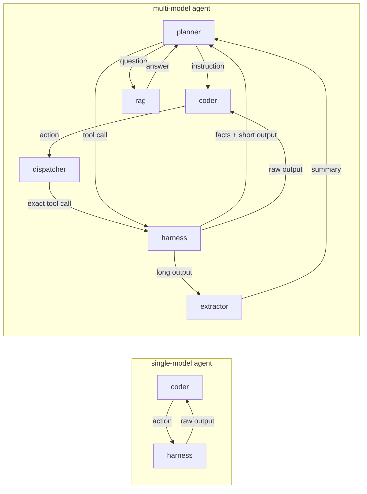

# How it works

This document explains the agent from the inside: the loop, the harness around
it, what each model actually sees, and the failures from real runs that shaped
each design decision. Code references are to `src/coding_agent/`.

## The whole idea in one loop

A coding agent is a loop around a model:

```python
while not done:
    action = model(task + workspace + recent tool output)   # decide
    result = harness.execute(action)                         # act
    memory.add(result)                                       # observe
```

`single_model.py` is exactly this, about 100 lines. Everything else in the repo
refines one of those three lines:

- **deciding better** — `loop.py` splits the decision across specialist models;
- **acting safely** — `harness.py`, `tools.py`, `sandbox.py`;
- **observing well** — what goes back into the next prompt (`CoderMemory`,
  observations, the extractor, the workspace snapshot).

The model never touches the filesystem. It writes text; the harness parses that
text into a tool call, decides whether to run it, runs it, and reports what
happened. Every interesting property of the agent — whether it can lie about
passing tests, whether it gets stuck, whether it corrupts files — is decided in
that harness, not in the model.

## The two agents



**Single-model** (`single_model.py`): one coder model reads the task, the
workspace and its recent tool output, and emits one action per turn —
`read_file`, `patch_file`, `write_file`, `run_shell` or `finish`.

**Multi-model** (`loop.py`): a team of small models, each with one job.

| Role | Job | Sees |
|---|---|---|
| planner | picks the next move: delegate to the coder, call a tool, ask rag, finish | task, workspace, last 8 observations |
| coder | turns one instruction into one code action | overall task, instruction, raw recent output |
| dispatcher | turns a messy action into an exact tool call | the action |
| extractor | compresses *long* tool output to small JSON | the output |
| rag | answers questions about the repo | retrieved code chunks |

The research question behind the repo is whether a team of cheap specialists
beats the coder alone. That is only a fair question if everything except the
deciding is identical, so both agents use the same `Harness`, the same tools,
the same test gate and the same guardrails. `eval/run_eval.py` runs either one
on the same tasks.

## The harness: the model proposes, the harness disposes

`harness.py` is the most important file to understand. Every tool call from
either agent goes through `Harness.execute`, which applies these rules in order:

1. **Validate.** Unknown tool or missing arguments → refused with a message the
   model can act on (`ToolResult.blocked`).
2. **Repeat breaker.** The third identical call in a row is refused. (The exact
   test command is exempt: re-running tests after an edit is legitimate.)
3. **Confirm.** With `--confirm`, ask the human — but only for calls that passed
   validation, so you are never asked about junk.
4. **Execute** through the sandbox or the file tools. File errors (missing,
   read-only, not UTF-8, an edit that would break Python syntax) come back as
   tool errors the model can read, never as crashes.
5. **Record facts.** If the command was *exactly* the configured test command,
   its exit code sets `tests_passed`. A successful edit clears it — and then,
   with `test_after_edit`, the harness runs the tests itself and reports the
   result in the same step.
6. **Stall check.** Fingerprint the outcome (tool, exit code, output with
   timings and addresses normalised). Seen 3 times in the last 8 steps → attach
   a warning. Seen `max_repeated_outcomes` times (default 5) → stop the run.
7. **Trace** the call and its result.

The result's `headline()` is one line computed from facts, never generated:

```
run_shell `python -m pytest -q` → exit code 1 — test command FAILED
patch_file `calc.py` → error
read_file `shop/cart.py` → NOT RUN (repeated identical call)
```

Every observation the planner sees starts with that line, and its system prompt
says to trust it over anything below it.

**The finish gate.** A run can only end successfully after the exact test command
exited 0 *and* nothing was edited since. When a model says "finish" too early,
the harness runs the tests itself; if they fail, the run continues with a note.
The eval goes one step further and never trusts the agent at all: it re-runs its
own verification command afterwards.

## What each model sees

Small models have small effective attention, even when their context window is
large. Most of the agent's quality comes from deciding what to put in front of
them.

**Workspace snapshot** (`workspace.py`), at the top of the first prompt: OS and
shell, *which Python* commands will run, the exact test command, git status and
recent commits, a file listing (junk directories skipped), and the head of
README/pyproject.

**Planner observations** (`AgentLoop._observe`):

- the headline (facts) first;
- output up to 600 characters verbatim — running a model to "compress" three
  lines costs a call and adds a chance to garble them;
- file reads up to 2,500 characters verbatim;
- anything longer goes to the extractor, and any verdict-like key it returns
  (`tests_passed`, `ok`, …) is deleted;
- only the last 8 observations are shown.

**Coder memory** (`CoderMemory`): raw tool output, newest last, kept under a
character budget derived from the coder's served context window
(`(ctx − max_tokens − 2000) × 3` characters). When a file is edited, older
copies of it are dropped so the next patch isn't based on stale text.

**Prompt order.** Stable parts first (system prompt, task, workspace), changing
parts last. llama-server reuses its KV cache for a prompt prefix it has already
processed, so a stable prefix makes every turn cheaper.

## Talking to small models

- **Forgiving parsing** (`llm.extract_json`): strips `<think>` blocks (even
  unterminated ones), prefers fenced JSON, then tries every balanced `{…}`.
- **Code travels outside JSON.** Small models cannot reliably escape newlines
  and quotes inside JSON strings, so the coder writes a one-line JSON header and
  puts code in raw `<old_text>`, `<new_text>` or `<content>` tags.
- **Normalise shapes in code before asking another model.**
  `ToolCall.from_obj` accepts `{"name", "arguments"}`, flat
  `{"name", "path"}` and keyed `{"read_file": {...}}`; `PlannerDecision`
  accepts a tool name in `"next"`. Each fix is a few lines and never fails.
- **Two error types** (`llm.py`). `ChatError` means the model answered badly:
  tell it what was wrong and ask again, on a separate attempt budget so garbage
  never eats real turns. `ModelUnavailable` means no answer was possible (server
  down, timeout, prompt larger than `ctx`): stop and tell the human. Mixing the
  two up makes an agent retry a dead server dozens of times.
- **Thinking costs time.** With Qwen3.5-2B as planner, thinking on (gpu-12gb)
  took 287 s for three eval tasks and thinking off (gpu-6gb) took 49–152 s, with
  no better pass rate. `thinking: true|false` is per role and is sent as
  `chat_template_kwargs.enable_thinking` on every request, so two roles sharing a
  model can differ.

## Lessons from real runs

Each of these happened in a real run of this project, was diagnosed from a trace
(`coding-agent trace`), and produced a fix you can find in the code. They are the
best part of this document: every agent you build will meet versions of them.

### 1. The agent ran the wrong Python for 17 turns

**Symptom.** Asked to fix a test, the planner spent 17 turns trying to install
pip: every command said `No module named pytest` / `No module named pip`.

**Cause.** The agent itself runs inside its own virtualenv, and child processes
inherit `PATH`. So `python -m pytest` in the *project* ran the *agent's*
interpreter, which has neither pytest nor pip. The project's own `.venv` (which
had pytest) was never used.

**Fix.** `sandbox.build_command_env`: put the project's `.venv/` or `venv/`
first, move the agent's venv to the end of `PATH`, and tell the model in the
workspace snapshot which Python it will get.

**Lesson.** The agent's environment is not the project's environment. Make the
difference explicit, and *show the model the facts of its environment*.

### 2. A 350M model reported that the tests passed

**Symptom.** In the same run, the planner's observations said
`"tests_passed": true` next to `"message": "No module named pip"`. The planner
saw "tests pass" on every turn while the gate said otherwise.

**Cause.** The original design sent *all* tool output through the extractor,
whose schema included `tests_passed`. Asked to re-derive a fact the harness
already knew exactly (the exit code), a tiny model guessed.

**Fix.** The harness owns facts (`ToolResult.headline`). The extractor's schema
has no verdict field, and any verdict key it emits is deleted. Short output skips
the extractor entirely.

**Lesson.** Never let a model re-derive what code already knows. Use models for
judgement, code for facts.

### 3. The repeat breaker was dodged by small variations

**Symptom.** The pip loop above sailed past the "third identical call" rule
because each command was slightly different (`python -m pip install --user pip`,
`python -m pip install --upgrade pip`, …). All of them failed the same way, with
`…\local-coding-agent\.venv\Scripts\python.exe: No module named pip`.

**Fix.** The stall detector fingerprints *outcomes*, not calls. After 3
identical outcomes in 8 steps the model gets an explicit "change approach"
notice; after 5 the run stops (`Stopped early: … the agent is stuck`). That
would have ended the pip run after about 6 turns instead of 17.

**Lesson.** Guard against the failure's effect, not its exact form.

### 4. The models ran slower than on the CPU

**Symptom.** The server logs show the 2B planner generating 9–20 tokens/s. On
the same laptop the same model generates 112 tokens/s on the GPU and 33 on the
CPU.

**Cause.** The original setup put all six models on the GPU, including an unused
embedder served at its default 128K context. `coding-agent doctor` on that setup
estimates ≈12.7 GiB on an 11.9 GiB card. On Windows the NVIDIA driver doesn't
fail when VRAM runs out; it spills into shared system memory, which is far
slower than either.

**Fix.** `serving.py` estimates each server's memory before starting it (weights
+ KV cache at the configured `ctx` + buffers, read from the GGUF header by
`gguf.py`) and refuses to start a fleet that won't fit. The profiles size `ctx`
deliberately, keep the small glue models on the CPU, let roles `share` a server,
and drop the unused embedder. `doctor --bench` flags a GPU model below 25 tok/s.

**Lesson.** On consumer hardware, memory planning is part of the agent.

### 5. The coder wrote whole patches on one line

**Symptom.** Trace of a single-model run:

```
{"action": "patch_file", "path": "calc.py"} + <old_text>def safe_divide(a, b):</old_text><new_text>def safe_divide(a, b): if b == 0:</new_text>
```

The `+` and the one-line layout came straight from the prompt, which had
summarised the format as `header {...} + <old_text>…</old_text><new_text>…`. The
3B model copied it literally and broke the file's syntax; later patches
couldn't match the mangled text, and every attempt made it worse.

**Fix.** The prompt now shows real multi-line examples (`roles._CODER_FORMAT`),
and `tools.check_syntax` rejects any edit that would leave a `.py` file
unparseable — the file is left unchanged and the error names the line. This is
the "lint on edit" idea from SWE-agent.

**Lesson.** Small models copy the *shape* of your examples exactly. And refuse
damage instead of letting it compound.

### 6. The coder pasted the prompt's example instead of the file

**Symptom.** After fix 5, the coder repeatedly sent an `old_text` of
`def safe_divide(a, b):\n    return a / b`. The real file had a comment line
between those two lines.

**Cause.** The prompt's example patch was about `safe_divide` in `calc.py` —
exactly the task. The model reproduced the example. The original prompt had the
same example, which also quietly gave one eval task its answer.

**Fix.** Examples about an imaginary `shop/cart.py`, and an explicit "use the real
file's text".

**Lesson.** Keep few-shot examples unrelated to anything the agent will really
see, or you will measure memorisation.

### 7. The planner couldn't see the code it was planning for

**Symptom.** The planner asked to read `calc.py` four times in a row; when it
finally delegated, the coder returned an error string instead of `0.0`.

**Cause.** File reads were summarised for the planner as "ok (3 lines)", so it
never knew what the file said. And the coder only got the planner's paraphrased
instruction, which had dropped "return 0.0".

**Fix.** Small files are shown to the planner verbatim; the coder always gets the
original task alongside the instruction.

**Lesson.** Compression has a cost. Give every model the facts its decision
depends on, and pass the user's words along unparaphrased.

### 8. Patching from memory

**Symptom.** Models frequently patch files they have never read, guessing the
content; the patch fails with "found 0", and they guess again.

**Fix.** When `old_text` isn't found, the error includes the file's current
content (up to 3,000 characters). In the traces the next attempt usually copies
it correctly.

**Lesson.** Error messages are prompts. Put the information needed to recover in
them.

### 9. The fix was made, then never checked — and then deleted

**Symptom.** On turn 2 the coder's patch fixed `calc.py`. The planner never ran
the tests; it kept issuing new "fixes", then ran `del calc.py` on the file it was
supposed to fix, and spent the remaining 20 turns trying to find it.

**Fix.** With `loop.test_after_edit` (on by default) the harness runs the test
command after every successful edit and reports the result in the same step
(`patch_file calc.py → ok — tests now PASS`). File deletion (`rm`, `del`,
`erase`, `rd`, `Remove-Item`) is on the default denylist, case-insensitively on
Windows. After this change the same example took 3 turns instead of 10–25.

**Lesson.** Don't leave cheap, mechanical decisions ("should I test now?") to a
small model. Do them for it.

### 10. Tests that ran yesterday's code

**Symptom.** Found by this repo's own test of fix 9: after editing `return 2` to
`return 3`, the tests still passed.

**Cause.** Python trusts a cached `.pyc` when the source file's modification time
(in whole seconds) and size match. Two edits within one second that keep the
size — exactly what an agent does — run the old bytecode.

**Fix.** Sandboxed commands run with `PYTHONDONTWRITEBYTECODE=1`.

**Lesson.** Agents act faster than humans; tooling built for human speed can
quietly misbehave.

### Also: hangs that aren't

A model's "fix" to binary search set `lo = mid`, making the test loop forever.
`subprocess.run(timeout=…)` would have killed only the shell; pytest would have
kept the output pipe open and hung the agent. `sandbox.run_command` starts each
command in its own process group, kills the whole tree on timeout, and writes
output to a file rather than a pipe, so a background grandchild can't make a
finished command look hung. stdin is a pipe closed at once: with `DEVNULL`, a
bare `python` on Windows thinks it has a terminal and waits at a prompt.

An independent review of the harness found most of the bugs in this last group
(and ten others, all with regression tests in `tests/test_regressions.py`):
non-string arguments crashing the run, a resumed session trusting a stale "tests
passed", a case-sensitive denylist on a case-insensitive shell, files with a
UTF-8 byte-order mark that could never be patched. Reviewing a harness with
adversarial inputs pays off as much as reading model traces.

## Evaluation

`eval/tasks/*.yaml` define small tasks: files to create, a prompt, a
verification command, and a scripted fix for `--mock`. A task passes only if the
verification command succeeds after the agent stops, whatever the agent claimed.

```bash
python eval/run_eval.py --profile gpu-6gb                 # multi-model
python eval/run_eval.py --profile gpu-6gb --single-model  # the control
python eval/run_eval.py --keep --tasks patch_off_by_one   # keep workdir + trace
```

Three tasks are enough to find harness bugs, not to rank models; runs at
temperature > 0 vary. To answer the multi-vs-single question, add 20–30 tasks
from your own projects and run each configuration several times. In the runs so
far the two agents pass about the same share of tasks, while the single model is
2–4× faster and uses a fraction of the tokens.
